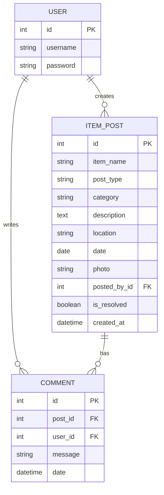
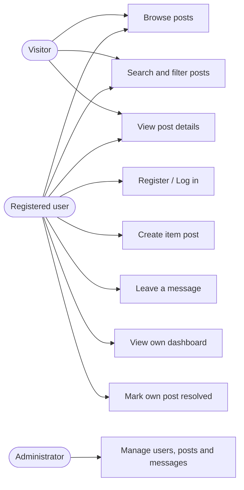
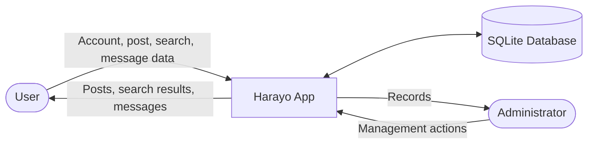

# Harayo App – BCA 4th Semester Project Documentation

## 1. Introduction
Harayo App is a web-based Lost and Found platform. It allows registered users to report items they have lost or found. Other users can search posts, view item details, and leave messages to ask about an item.

## 2. Problem Statement
People often lose personal belongings in colleges, public places, and communities. Information about lost and found items is usually shared through scattered messages or notices. Harayo App provides one place where these reports can be published and searched.

## 3. Objectives
- Provide a common platform for Lost and Found reports.
- Allow users to register and log in.
- Allow users to create posts with item details and an optional photo.
- Help users search by keyword, post type, and category.
- Allow users to view details and leave a message for a post owner.
- Allow post owners to manage their posts and mark items as resolved.

## 4. Scope
The project is designed as a small community or college-level website. It uses Django and SQLite and can be run locally for demonstration. It is not a verified identity service or an emergency service. Messages on a post are public; users should not share private contact details in them.

## 5. Tools and Technologies
| Component | Technology |
|---|---|
| Front end | HTML, CSS, JavaScript |
| Back end | Python, Django |
| Database | SQLite |
| Image handling | Pillow |
| Development environment | Python and VS Code / CMD |

## 6. Main Modules
1. **User module:** signup, login, logout.
2. **Post module:** add, view, search, filter, and mark posts resolved.
3. **Dashboard module:** view posts created by the logged-in user.
4. **Message module:** add and view messages on an item detail page.
5. **Admin module:** Django admin can manage users, posts, and comments.

## 7. Functional Requirements
- A visitor can view active Lost and Found posts.
- A user can create an account and log in.
- A logged-in user can add an item post with a type, category, description, location, date, and optional photo.
- A visitor can search posts and filter by Lost/Found and category.
- A visitor can open a post detail page and read its messages.
- A logged-in user can add a message to a post.
- A logged-in user can view their dashboard and mark their own posts resolved or reopen them.
- Only the owner of a post can change its resolved status through the website.

## 8. Non-Functional Requirements
- The website should be simple to use.
- The layout should adapt to desktop and mobile screens.
- Forms should validate important input.
- Login-required actions should be restricted to authenticated users.
- SQLite stores project data locally.

## 9. Database Design / ER Diagram


## 10. Use Case Diagram


## 11. Data Flow Diagram (Level 0)


## 12. Testing Plan
| Test | Action | Expected result |
|---|---|---|
| T1 | Open home page | Active posts are displayed |
| T2 | Register with valid details | Account is created and user is logged in |
| T3 | Open Add Post while logged out | User is asked to log in |
| T4 | Submit a valid item post | Post is saved and appears in the app |
| T5 | Submit a very short item description | Validation message is shown |
| T6 | Search for an item name | Matching posts are displayed |
| T7 | Filter by Lost/Found or category | Matching posts are displayed |
| T8 | Open a post detail page | Full item details and messages are shown |
| T9 | Leave a message while logged in | Message appears on the detail page |
| T10 | Mark own post resolved | Status changes in the dashboard |
| T11 | Try to resolve another user's post | Action is not permitted |
| T12 | Open the site on a narrow screen | Layout adjusts for mobile |

## 13. Installation and Execution
1. Extract the ZIP file.
2. Open CMD in the folder containing `manage.py`.
3. Create and activate an environment:
   ```cmd
   python -m venv newenv
   newenv\Scripts\activate.bat
   ```
4. Install packages:
   ```cmd
   pip install -r requirements.txt
   ```
5. Apply database migrations:
   ```cmd
   python manage.py migrate
   ```
6. Start the server:
   ```cmd
   python manage.py runserver
   ```
7. Open `http://127.0.0.1:8000/` in a browser.

Optional administrator account:
```cmd
python manage.py createsuperuser
```
Then open `http://127.0.0.1:8000/admin/`.

## 14. Limitations
- The project uses a local SQLite database and is intended for academic demonstration.
- It does not verify whether an item really belongs to a person.
- Messages are public comments, not private chat.
- A real public deployment would need additional security, privacy, backup, and hosting configuration.

## 15. Future Enhancements
- Private messaging or a moderated contact request system.
- Email notifications when someone replies.
- Admin review and reporting of suspicious posts.
- Pagination for large numbers of posts.
- Deployment to a secure hosting service.

## 16. Conclusion
Harayo App demonstrates how a database-driven web application can help a community share information about lost and found belongings. It combines authentication, CRUD operations, search, filtering, image upload, database relationships, and responsive web design in a manageable student project.
